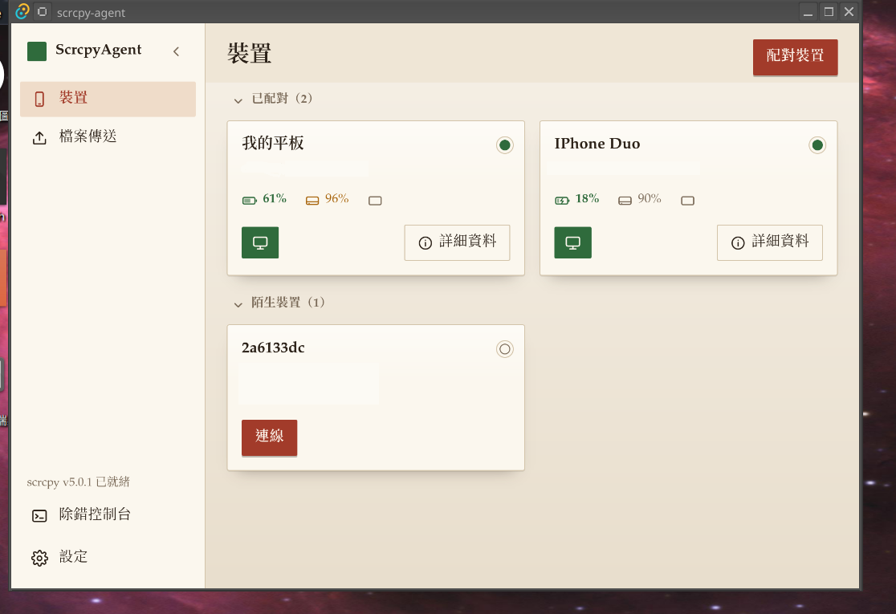
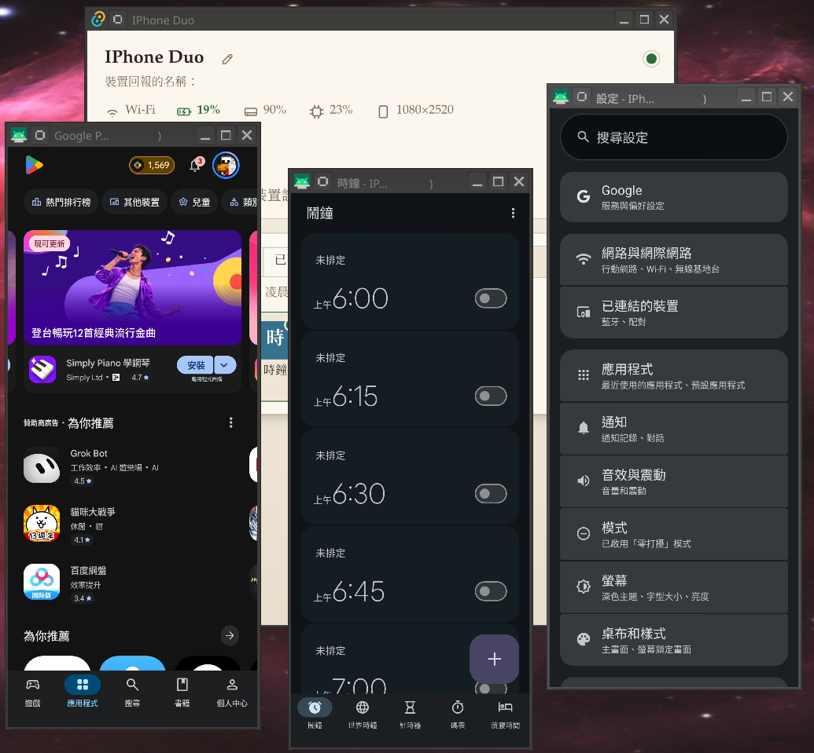
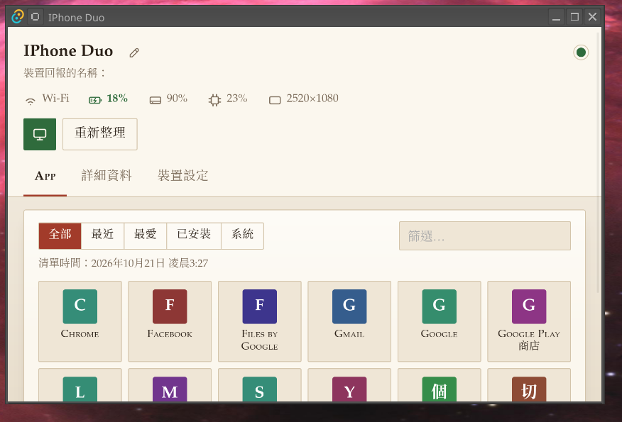
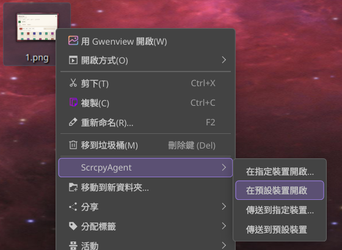

# scrcpy-agent

**English** | [繁體中文](README.zh-TW.md)

A desktop service built on [scrcpy](https://github.com/Genymobile/scrcpy). It runs in the system tray, finds Android
devices on the local network, reconnects paired devices, and opens their screens. Add-ons written in JavaScript extend it.



## Features

- **Device discovery and connection.** Wireless debugging is followed through mDNS and adb. Only paired devices are
  connected; other devices on the same network are not. When a paired device stops announcing itself (for example while
  its screen is locked), its last known address is tried. USB devices are supported as well.
- **Screens.** The screen of a device, or the window of a single app on a display of its own, with a floating toolbar
  (back, home, rotate, … and the buttons add-ons add). The buttons shown and their order are set in the settings.
- **Files.** Sending files to a device and opening a file on it, from the program or from the context menu of the file
  manager (Windows Explorer; Dolphin, Nemo and Nautilus on Linux).
- **Tray.** Closing the main window hides it to the system tray and the program keeps running (the setting
  `close_to_tray` turns this off). The program can also start at login.
- **Appearance.** Themes (CSS) and language packs. English and Traditional Chinese are built in.
- **Add-ons.** A folder with `addon.json` and `main.js`, run in a sandboxed JavaScript engine (QuickJS) with the
  permissions granted at install. An add-on can add menu entries and toolbar buttons, react to events, declare settings
  (the program draws the form), run shell commands on a device, start programs on the computer, and receive the live
  video of a screen (for example for image recognition).

scrcpy, adb and the scrcpy server are not included. On first run the program asks for confirmation before downloading a
scrcpy release from the official GitHub releases (the archive contains all three, so their versions always match); the
file name, size and SHA-256 are shown first. The default is v5.0.1, the release the program is tested with; the version
is a setting.

## Screenshots







## Install

Packages are attached to the [Releases](https://github.com/weiking1021/scrcpy-agent/releases) page:

| System | Package |
|---|---|
| Windows | the installer (`…_x64-setup.exe`; per user, no administrator needed) or the portable zip (a `portable.txt` next to the program keeps its data there) |
| Linux (x86_64) | the `.deb` package (needs WebKitGTK 4.1, GTK 3 and the Ayatana app indicator; `apt install ./…deb` installs them) or the plain executable |

Device requirements: Android 11 or later with **Developer options → Wireless debugging** on, paired once from the program
("Pair a device"). A device connected by USB with USB debugging on does not need pairing.

## Add-ons

- Writing an add-on: [docs/ADDONS.md](docs/ADDONS.md) ([繁體中文](docs/ADDONS.zh-TW.md)); a working example is in
  [docs/example-addon/](docs/example-addon/).
- TypeScript types: the package `scrcpy-agent-addon-api`, built by `npm run addon-types` as a `.tgz` in `out/` (it is not
  published to npm).
- Themes: [docs/theming/THEMING.md](docs/theming/THEMING.md).

An add-on can only use the permissions ticked at install. `run_process` (programs on the computer) and `screen_capture`
(the picture of a device's screen) are shown with a warning.

## Build from source

Requirements: [Rust](https://rustup.rs/) (stable), Node.js, and the
[system libraries Tauri 2 needs](https://tauri.app/start/prerequisites/) (on Windows the MSVC build tools and WebView2;
on Linux `libwebkit2gtk-4.1-dev`, `libayatana-appindicator3-dev`, …).

```
npm install
npm run tauri dev        # run, rebuilding when a file changes
npm run tauri build      # the program and the installer for this system
npm run package          # Docker: the Linux and Windows packages and the add-on types, into out/
```

Tests use a fake adb and a fake scrcpy (`src-tauri/examples/`) and need no device:

```
cd src-tauri && cargo clippy --all-targets && cargo test
npx tsc --noEmit && npm run check:locales
```

## Reporting a problem

Problems are reported on the [Issues](https://github.com/weiking1021/scrcpy-agent/issues) page. A report is most useful
with the version of the program, the operating system, the steps that lead to the problem, and the relevant lines of the
debug console. Device serial numbers, addresses and names should be removed from pasted text.

## License

[MIT](LICENSE). scrcpy is a project of Genymobile under the Apache License 2.0; this program is not affiliated with it.
